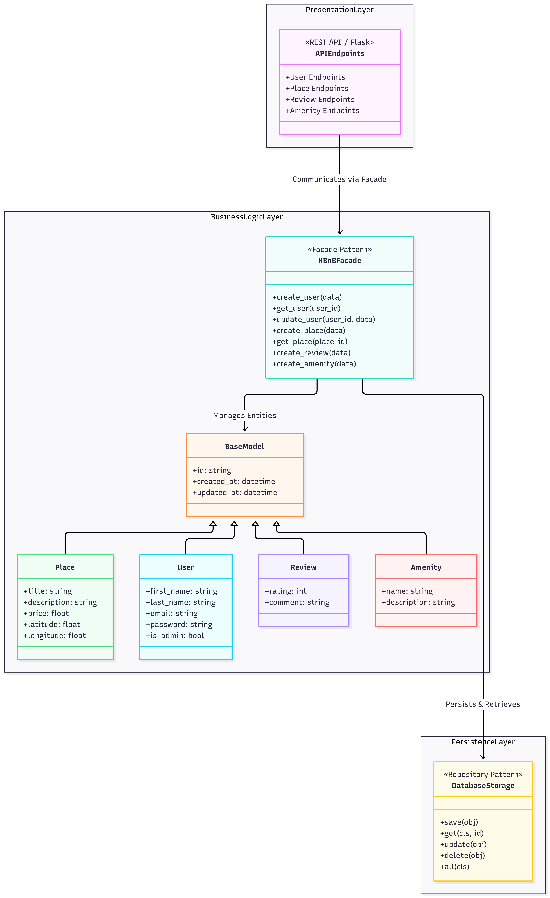
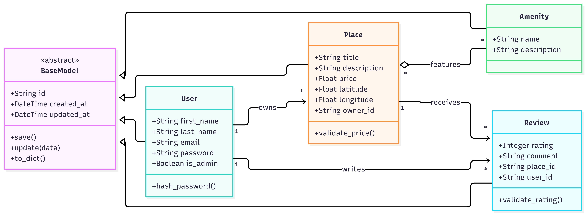
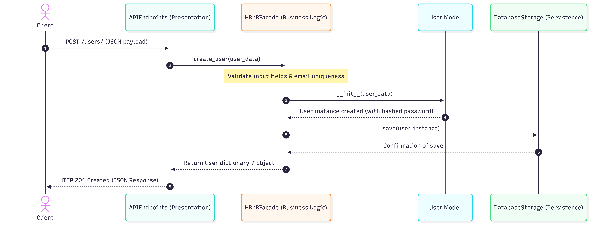
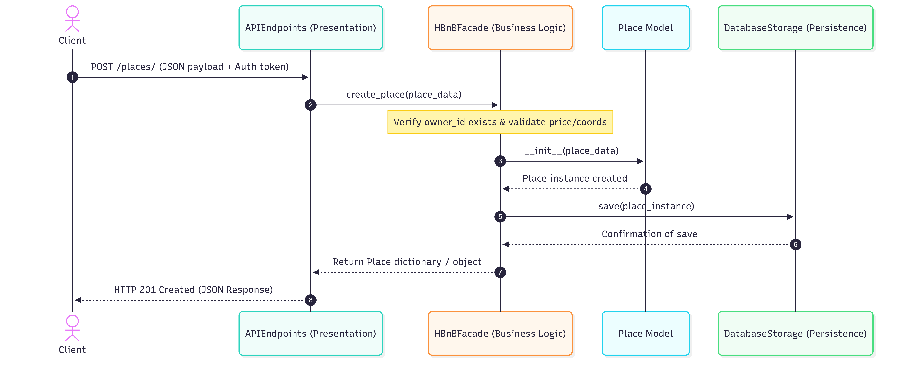
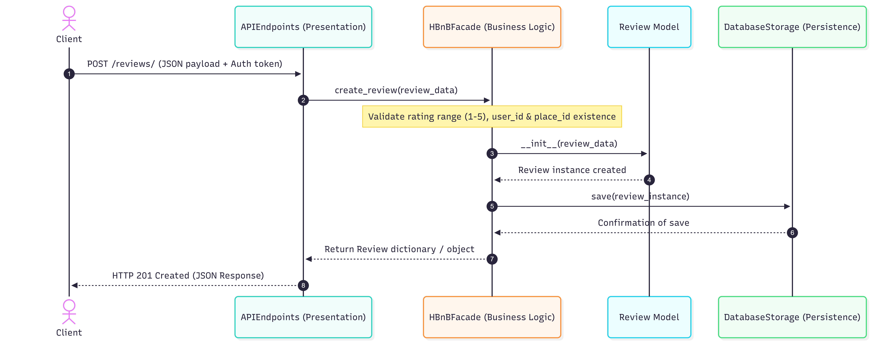
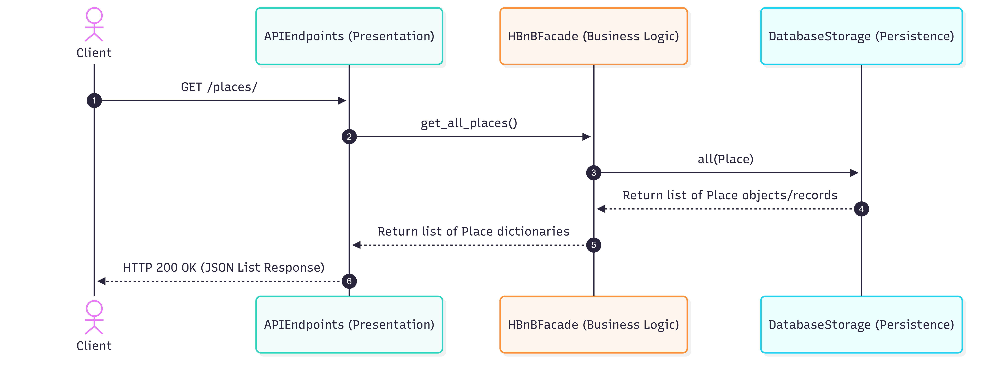

# HBnB Evolution — Technical Documentation (Part 1)

## 1. Introduction

### Project Overview
The **HBnB Evolution** application is a simplified, scalable AirBnB-like clone designed to handle primary operations including user management, property listing creation, review submissions, and amenity management. Built as part of the Holberton School curriculum, this project focuses heavily on robust software engineering principles, modularity, maintainability, and clean architecture.

### Purpose of This Document
This technical document serves as the foundational architectural blueprint for the HBnB project. By defining the high-level system structure, detailed business logic entities, and precise API interaction flows prior to implementation, this guide ensures consistency across all development phases—from database schema mapping to backend API services and frontend presentation.

---

## 2. High-Level Architecture

### High-Level Package Diagram
The application follows a strict **3-Layer Architecture** divided into the Presentation Layer, Business Logic Layer, and Persistence Layer. Communication between the Presentation Layer and internal subsystems is mediated via the **Facade Pattern**.

### Explanatory Notes & Design Rationale
* **Layer Separation:** The **Presentation Layer** handles HTTP handling, parsing, and response formatting. It is strictly isolated from business rules and data storage. The **Business Logic Layer** enforces core application constraints, while the **Persistence Layer** handles low-level storage routines.
* **The Facade Pattern (`HBnBFacade`):** To avoid tight coupling between controllers/endpoints and internal domain logic, all requests route through a single facade entry point (`HBnBFacade`). This simplifies client interactions and shields the API from underlying structural refactoring.

---

## 3. Business Logic Layer

### Detailed Class Diagram
The Business Logic layer contains the core models of the application. All core entities inherit from a common `BaseModel` to ensure uniform tracking of unique identifiers and audit timestamps (`created_at`, `updated_at`).

### Explanatory Notes & Entity Relationships
* **`BaseModel`:** Provides foundational attributes (`id`, `created_at`, `updated_at`) and utility methods (`save`, `to_dict`) inherited by all domain entities.
* **`User` (1-to-Many with `Place` & `Review`):** A user can register, update profiles, own multiple properties, and submit multiple property reviews.
* **`Place` (1-to-Many with `Review`, Many-to-Many with `Amenity`):** Represents a rental property linked to a specific owner, capable of accumulating feedback reviews and mapping to multiple features/amenities (e.g., Wi-Fi, Pool).

---

## 4. API Interaction Flows

### Sequence Diagrams for API Operations
The sequence diagrams below illustrate the exact runtime flows across the application layers for core operations.

#### 1. User Registration Workflow

#### 2. Place Creation Workflow (`POST /places`)

#### 3. Review Submission Workflow

#### 4. Fetching Places Workflow (`GET /places`)

### Explanatory Notes on Data Flow
1. **Request Intake:** The `APIEndpoints` layer receives HTTP requests with payloads or query parameters.
2. **Facade Orchestration:** The API delegates processing entirely to `HBnBFacade` methods.
3. **Model Instantiation & Validation:** The Facade validates and instantiates domain models.
4. **Persistence:** Objects are passed to the `DatabaseStorage` repository engine, writing or retrieving records from the persistence layer.
5. **Response Delivery:** Confirmation or data resources travel back up the chain, returning proper HTTP status codes and serialized JSON to the client.
